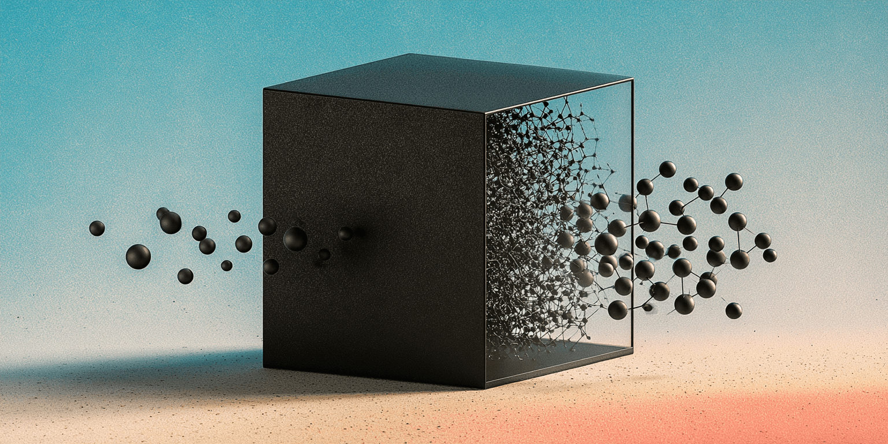
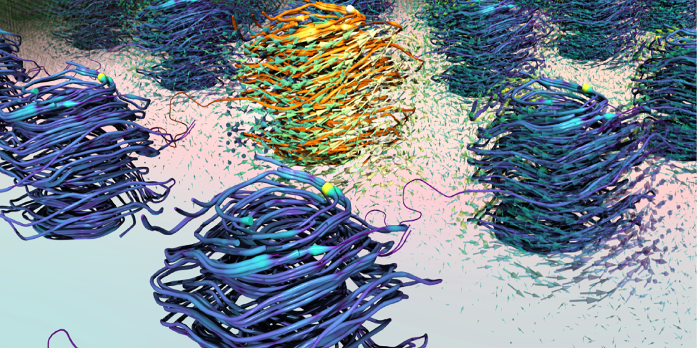

Welcome to my website! I am currently an Associate Professor of Materials Science and Chemical Engineering Practice at University of Southern California. My research focuses on atomistic simulations using AI, Machine Learning, and High-performance computing, and educate next generation cyber-workforce at the nexus of exascale computing, artificial intelligence (AI) and quantum computing.

## News

  <strong><a href="https://viterbischool.usc.edu/news/2026/08/can-ai-understand-a-fundamental-concept-of-chemistry/">Can AI "Understand" a Fundamental Concept of Chemistry?</a></strong>
  

    
    

      USC Viterbi researchers found that a powerful AI model independently learned the chemical bond, a foundational chemistry concept it was never taught. 
      <em>August 2026, USC Viterbi School of Engineering</em>
    

  

  <strong><a href="https://www.alcf.anl.gov/news/argonne-s-aurora-supercomputer-drives-groundbreaking-simulations-explore-how-light-shapes">Argonne's Aurora Supercomputer Drives Groundbreaking Simulations to Explore How Light Shapes Quantum Materials</a></strong>
  

    
    

      Using the Aurora exascale supercomputer, the team ran the largest-ever simulations of light interacting with quantum materials, modeling over a trillion atoms to reveal how light can switch the structure of ferroelectric topological materials. 
      <em>November 2025, Argonne Leadership Computing Facility</em>
    

  

  <strong><a href="https://viterbischool.usc.edu/news/2025/07/discovering-new-materials-ai-can-simulate-billions-of-atoms-simultaneously/">Discovering New Materials: AI Can Simulate Billions of Atoms Simultaneously</a></strong>
  

    
    

      Allegro-FM, an foundation model for materials, can simulate billions of atoms at once, enabling virtual tests of carbon-capturing, longer-lasting concrete before costly lab experiments. 
      <em>July 2025, USC Viterbi School of Engineering</em>
    

  

